# State-conditioned frontier policy: design

Status: design approved by Felipe for this method direction. The isolated feasibility mask, deterministic replay, coverage accounting and independent validator primitives have partial implementation and adversarial unit coverage; actor training, pipeline integration and empirical evaluation remain pending. See the [versioned SDD amendment](SDD-amendment-0.12.000.md) for the formal schedule definition, research transfer limits, frozen evaluation, compute cap and release boundary.

## Decision flow

```mermaid
flowchart LR
  A[Seeded synthetic graph generator] --> B[Train-only feature and split ledger]
  B --> C[Masked PPO policy training]
  C --> D[Frozen checkpoint and checksum]
  D --> E[Precedence and resource action mask]
  E --> F[Deterministic frontier decisions]
  F --> G[Independent CPIT schedule validator]
  G --> H[Paired evaluation and complete failure ledger]
  H --> I[Validated 0.12.000 all-case bake]
  I --> J[Static app replays committed schedules]
```

## Why a mask is necessary and insufficient

Resource-constrained scheduling research demonstrates a useful separation: a learned policy prioritizes eligible tasks, while a schedule-generation procedure restores precedence and resource feasibility. The SIREN study evaluates this pattern for RCPSP and explicitly limits its graph-size generalization evidence ([Teichteil-Königsbuch et al. 2023](https://doi.org/10.1609/icaps.v33i1.27244)). PhaseFlow adapts the state/action boundary to its block-level discounted-value objective; it does not reuse RCPSP makespan labels or claim transfer. Mining-complex RL likewise uses a different decision horizon and operational model ([Kumar and Dimitrakopoulos 2021](https://doi.org/10.1016/j.asoc.2021.107644)).

The action mask prevents the policy from selecting an infeasible block. The independent schedule validator remains necessary because defects can still enter through feature-to-block mapping, period advancement, export, or aggregation. A policy error is recorded as a failed method result. It is never repaired and counted as a frontier-policy result.

## Inputs, state and objective

The encoder receives the precedence graph and source-contract fields. Dynamic features are recomputed after each accepted action from assigned blocks, period index and residual capacities. It consumes no identifier that reveals an evaluation split or outcome. The policy's episode reward is the incremental value already discounted by PhaseFlow's evaluator, and the optimizer's return factor is one to avoid applying a second temporal discount.

At each period, the policy scores only unassigned blocks whose predecessors are already scheduled by that period and whose full resource vector fits. A stop-period decision advances to the next period; stop-schedule ends with a feasible partial schedule. The trace reports coverage next to NPV and marks partial schedules explicitly.

## Training and evaluation separation

Generated training graphs are grouped by both seed and generator family. Validation selects checkpoints and frozen hyperparameters. Test graphs and product benchmark cases are not used to change features, thresholds or stopping rules. Product evaluation opens once after the checkpoint is frozen and compares paired cases with BS-1, the applicable published scheduler and exact expected-time ordering when certified.

The GPU/CPU checkpoint lives in the configured device model root. Training inputs and temporary rollout buffers live in the configured training/data roots. The repository keeps the feature contract, code, pinned training configuration, split manifest, hashes, reports, tests and allowed derived output. CI and deployment never train.

## Product interpretation

The product page calls the method **Frontier policy**. It shows whether a schedule is complete, the share of scheduled tonnes and value, NPV, a comparable certified gap when one exists, runtime, and per-case provenance. It states that these are offline results on the declared benchmark. If the method is worse than a baseline, that result remains visible and no superiority wording appears. The route replays the committed schedule; it does not load the checkpoint or promise live support.

## Notebook units

Add a mirrored EN/ES pair that walks through the decision state and feasible-action mask with a runnable small synthetic graph, then a second mirrored pair that trains under the frozen receipt and evaluates the checkpoint on untouched synthetic groups and final product traces. Each notebook reads the method implementation, prints the seed/split and checkpoint receipt, independently validates schedules, reports numeric results and failures, and interprets its plots. The release notebooks are regenerated from the final 0.12.000 data and pass both the content gate and fresh-kernel byte-stability check.
